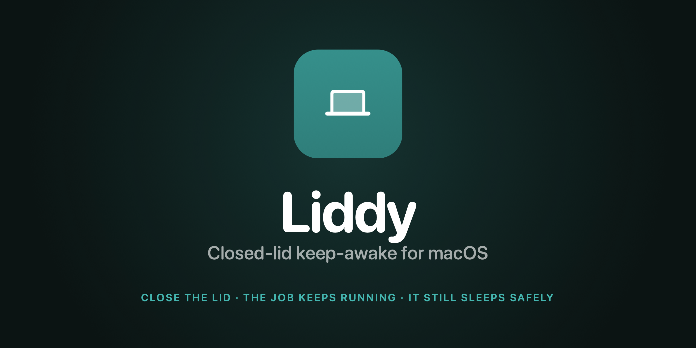

<p align="center">
  
</p>

# Liddy

### Your agent is still working. You want to close the lid and go to bed.

Every keep-awake tool on the Mac fights idle sleep. None of them survive the lid
closing — because no power assertion can stop clamshell sleep. The only lever
that works is a global, sticky, root-only setting that, left on, means your Mac
stops honouring the lid close for every app, indefinitely, including in a bag.

Liddy is a guarded wrapper around that one toggle. A root daemon owns it on a
deadman switch, a tested governor watches the battery and the thermal state, and
the work itself says when it is working.

Free, open source, no licence check, no telemetry, no account.

```
liddy claim "overnight migration" --ttl 300   # declare live work
liddy lid on --timer 8h                       # close the lid and walk away
liddy log                                     # in the morning: why it stopped
```

> **Read this before closing the lid.** A closed lid cuts off the main airflow
> path. Hard ventilated surface, on mains power — **never** a bag, a bed, or a
> drawer. And run [`verify-deadman.sh`](#verify-the-safety-claim-before-trusting-it)
> once before you trust it overnight: that the setting reverts when the app dies
> is the entire difference between Liddy and a raw `pmset -a disablesleep 1`.

## Why this needs to exist

macOS has **two** sleeps, and most keep-awake tools only fight one.

| | Trigger | What stops it |
|---|---|---|
| **Idle sleep** | inactivity | a power assertion (`IOPMAssertionCreateWithName`) — what `caffeinate` and every menu-bar keep-awake app uses |
| **Clamshell sleep** | the instant the lid closes | **no power assertion can stop it** |

There are exactly two public ways to survive a lid close: attach an external display on AC power, or set `pmset -a disablesleep 1`. There is no third lever, no kernel extension, no private API.

So closing the lid on a running agent means flipping `disablesleep` — a **global, sticky, root-only** setting with no on-screen indicator that a reboot does not reliably clear. Forget the matching `disablesleep 0` and your Mac stops honouring the lid close for every app, indefinitely, including in a bag.

That risk *is* the product. Liddy is a guarded wrapper around that one toggle.

## What makes it safe

**The helper owns the toggle, on a deadman switch.** `disablesleep` is set by a root launchd daemon, not by the app. While it is on, the app must hold a socket open and heartbeat every 5s. The helper reverts on:

- the app disconnecting (crash, force-quit, kill -9) — immediately
- 15s without a heartbeat (app hung or wedged)
- `SIGTERM` / `SIGINT`
- its own startup, if it finds the setting left on

Four independent paths back to normal sleep. Reverting only on next launch — which is what comparable tools do — leaves a wedged Mac unable to sleep for however long it takes you to notice.

**The governor is pure and tested.** Readings in, verdict out, no side effects — so the rules deciding whether an overnight run survives are directly testable rather than inferred from the app looking plausible.

| Rule | Default | Action |
|---|---|---|
| Hard battery floor | 4% (4–8) | `pmset sleepnow` — must beat *every* assertion, not just ours |
| Critical thermal, lid shut | — | force sleep (no airflow, so releasing is not enough) |
| Soft battery floor | 20% (15–50) | release, sleep normally with headroom to resume |
| Thermal ceiling | critical | release |
| Charging-only | off | release on battery |

Both floors are on for everyone. A guardrail behind a paywall is not a guardrail.

**A safety stop stays stopped.** Releasing the Mac does not stop the work — `claude` and `cargo` are still running, so the very next process scan wants to hold again. Left alone that turns a battery floor into a 10-second flap: release, re-acquire, release, forever, re-notifying you each time and never actually letting the Mac sleep. So a governor stop also *blocks* re-arming, and neither auto-watch nor `liddy claim` can lift it.

Recovery needs real clearance, not one point over the line. The block lifts only when the governor is fully satisfied — which, because it already warns until you are 10 points clear of the floor, means a release at 20% re-arms at 30% or on mains power. Clearing any earlier just reproduces the flap in slower motion. An explicit `liddy start` overrides the block, once: the governor gets the next word five seconds later and stops it again if it was a bad idea, with the reason in `liddy log`.

The menu bar calls this state **Holding back**, distinct from **Idle** — idle means nothing wants the Mac awake, holding back means something does and it is not being allowed.

**Every session records why it ended** — finished, timer, battery, thermal, manual, or heartbeat lost. `liddy log` instead of guessing from a cold trackpad.

## Agent awareness: claim, don't guess

Name-matching a process is a guess. Liddy prefers letting the work **declare itself**:

```bash
TOKEN=$(liddy claim "fine-tune run" --ttl 300)
trap 'liddy release $TOKEN' EXIT
./train.sh
```

A lease has a TTL, so a claimer that dies stops holding the Mac on its own — nothing has to notice it crashed. Auto-watch still exists as a fallback, and treats a matched process as working **by existing, never by CPU** (an agent sits near 0% CPU waiting on an API between tool calls; a CPU threshold would drop the Mac mid-task).

Two things the matcher gets right that a naive one does not:

- **Exact match on the executable basename**, not substring on the full path. `rsync` otherwise matches macOS's own `appplaceholde`**`rsync`**`d`; `uv` matches `UVCAssistant`; `docker` matches the always-running `com.docker.vmnetd`. Any one of those holds an idle Mac awake forever. Locked down in `ProcessWatcherTest`.
- **Server-shaped tools are not watched by default** — `ollama serve`, the Docker Desktop backend, colima, a `vite` dev server all run for as long as they are open. Those belong to `liddy claim`.

> **Tune this for your machine.** `npm`, `python` and `uv` are in the defaults for long training runs and builds — but if you run MCP servers, those same names are live permanently and Liddy will never let go. Check with `liddy status`; drop them with `liddy unwatch npm` and use `liddy claim` instead.

`liddy -- <command>` also registers a renewing lease when the app is running, so a wrapped command is covered by the battery and thermal floors. Only when the app genuinely is not running does it fall back to a bare assertion — and it tells you so on stderr.

### Claude Code hooks

```bash
liddy hook install              # ~/.claude/settings.json
liddy hook install --project    # ./.claude/settings.json
liddy hook print                # just show the JSON
```

Claude Code then holds your Mac awake **exactly while a turn is running**:

| Event | Action |
|---|---|
| `UserPromptSubmit` | claim, keyed by `session_id` |
| `Stop` | release |
| `SessionEnd` | release (backstop) |

Hooking `SessionStart`/`SessionEnd` instead is the obvious choice and is wrong: a session left open in a terminal overnight would hold the Mac awake with nothing running — the same failure as watching a server process.

Claims are keyed and idempotent, so firing on every turn renews one lease instead of leaking one per turn, and each carries a 1h TTL so a session that dies mid-turn releases itself. Install is idempotent, and every hook path exits 0 — including "Liddy isn't running" and malformed stdin. A keep-awake tool being absent is not a reason for your prompt to fail.

## The menu bar

The switch is first. Everything under it explains what the switch is doing — **why is my Mac awake**, and **what will stop it**. The menu-bar glyph carries the battery percent next to it, so the number that can end a hold is visible without opening the panel.

**Off stays off.** Turning the hold off by hand pauses auto-watch too. Without that, "off" is meaningless in the only situation you would ever use it: the watched processes are still running — that is *why* the Mac was awake — so the next scan re-acquires within ten seconds and the switch flips itself back on while you are looking at it. The panel says **Paused by you**, and names how many things are running that it is now ignoring. An explicit `liddy claim` lifts the pause, because a script saying "I am working now" is somebody asking out loud; a pause set on Tuesday should not silently cost you Friday's overnight run.

Only a hand-made stop pauses. Work finishing or a timer expiring is the system doing its job, and the next real workload holds normally.

Three rings across the top, each one a quantity that can end a hold — battery (with IOKit's own time-remaining estimate, amber exactly at your soft floor, red at the hard floor), thermal against your ceiling, and either the session timer counting down or the live lease count when nothing is timed. A ring holds a *number*; a state (thermal) puts its symbol in the ring and the word in the caption, because a word wide enough to say "Very hot" renders straight over the stroke.

Under them, what is holding the Mac, a sparkline of lease activity over the last ~4 minutes (48 samples at the runtime's 5s tick — the strip carries its own "last 3m" label, since a chart that makes you guess its span will be guessed wrong), and a segmented bar for a timed session's progress.

### Tab Warden

Every live CLI agent session on this Mac, as a wrapping row of pills — the repo name, the agent's real app icon (borrowed from the copy installed on this Mac; nothing is redistributed), and a state colour. Tool, branch, age and directory are on hover.

| Colour | State | Means |
|---|---|---|
| green | working | writing to its transcript right now |
| blue | running | alive; this tool publishes no per-turn activity |
| amber | your turn | alive and quiet — it is waiting on you |
| grey | idle | alive but untouched for 15 minutes |

```
$ liddy session
working   Claude  4s   liddy (main)
working   Claude  36s  blead (feat/linkedin-job-source)
running   Grok    26m  biasd
your turn Claude  1m   blead (feat/linkedin-job-source)
idle      Claude  26m  booted (main)
```

**Why files rather than processes.** A process tells you `claude` is running. It cannot tell you which project, which branch, how many sessions, or whether the model is mid-turn. Every one of these tools already writes a per-session record and stamps it with the working directory — Claude and Codex a JSONL transcript, Cursor a `meta.json`, Grok an explicit `active_sessions.json` with a pid — so the filesystem holds the exact answer, and the modification time is a far better activity signal than CPU. An agent blocked on an API response sits at 0% CPU while genuinely working; its transcript grew two seconds ago.

Processes are still used for one thing: whether a session is *alive*. A transcript is just as fresh five seconds after you quit the CLI as five seconds before, so liveness is matched separately, by working directory.

This replaced a per-vendor Agents list whose working/idle flag came from whether Liddy held a *lease*. That flag was wrong in the worst direction — an agent that was genuinely running read as idle, because no lease exists unless the Claude Code hook claimed one or the process watcher matched a name in `watchPattern` while auto-watch was on and a hold was live. Grok was not in the default pattern at all, so it could never read as working. Session state no longer depends on Liddy being involved.

### Settings

Every threshold that governs a run is editable in the panel — both battery floors, the thermal ceiling, the idle-release window, charging-only, auto-watch, and network probing. These were `liddy set`-only, which put the numbers deciding whether an overnight run survives behind a command you have to remember. The panel already *draws* the floors (the battery ring turns amber at the soft one), so it should be able to move them.

**Open at login** lives in the same section. A menu-bar app with no Dock icon is otherwise gone after a reboot; Login Items are how it comes back. The toggle is disabled until `Liddy.app` is in `/Applications`, because that is the path macOS resolves.

Changes apply to the live governor immediately, not on next launch: a floor you just raised should protect the run you are in the middle of.

### The panel is five pages, not one scroll

An icon bar along the bottom switches pages: **Now** (the switch, the rings, live sessions), **Apps** (what is eating the machine), **Health**, **Settings**, **Activity**. A dot on the Health glyph means a check is failing, visible from whichever page you are on.

Pages have a fixed height, so the window never resizes — not when a section opens, not when a health sweep lands, not on a tick. That is a deliberate structural choice rather than a style one: every panel bug this project has had (a one-frame jump on expand, a measurement loop that grew the window to fill the screen, content clipped off the top, a 1330pt content height) came from a window whose height was a function of its content. Pages remove the cause. A page with more content than fits scrolls inside the page.

### While a run is going

Three things happen during a hold that you do not have to ask for.

**The screen goes off when the lid shuts.** A closed panel that is still lit is watts and heat spent on a display nobody can see. Liddy reads the kernel's own `AppleClamshellState`, turns the backlight to zero when the lid closes on one of its sessions, and puts it back at exactly the level you left it when the lid opens. The level is saved *once* — re-reading it on a later tick would capture the zero Liddy wrote and restore the panel to black — and it is restored on quit, on a safety stop, and if you turn the feature off mid-run. If the level cannot be read, nothing is dimmed: a brightness that cannot be restored is not worth taking.

There is no public API for this on Apple silicon, so `DisplayServices` is `dlopen`ed and its three symbols looked up at runtime rather than linked. If a future macOS renames them, the feature turns itself off and closed-lid mode keeps working.

**Using the most** lists the apps actually eating the machine, collapsed per app — Chrome's dozen renderers report as one row, which is the only grouping worth reading. It is visibility, not a decision: nothing in the governor reads it, and a CPU threshold driving the hold stays rejected for the reason in [Agent awareness](#agent-awareness-claim-dont-guess) — an agent waiting on an API sits near 0% CPU. The same sample is written into the log at every stop, so "Battery crossed the floor" is followed by the three processes that put it there.

**Backgrounding** (off by default) hides apps while a hold runs and unhides them when it ends. The scope depends on the lid: **open**, it hides only the apps you listed, because you are looking at that desktop. **Shut**, it hides everything that is not keeping the work alive — there is no screen to look at, and that is exactly the window where an idle app's CPU costs battery and heat behind a closed panel with no airflow. Terminals are never hidden (every agent session runs inside one), nor is an app with a live session, nor Liddy or Finder. Hiding, not quitting and not `SIGSTOP`: occluded windows stop drawing and the app becomes a candidate for App Nap, which is the mechanism macOS itself uses. `SIGSTOP` frees more CPU and corrupts a browser session; `renice` cannot be undone without root, so a "temporary" deprioritise would outlive the run. The app you are actually using is never hidden, an app you unhide yourself is not re-hidden, and everything taken is given back on release, on a safety stop, and on quit.

### Health

The health panel is **off by default** — a direct user report that the panel was mostly text. The checks still run: a failing one still turns the menu-bar glyph into a warning triangle, and still appears in the panel as a single line you can tap to turn the full section back on. What the toggle controls is whether the *passing* rows are drawn.

With it on — collapsed to one dot per group, expanded to every check. **A failing check is never hidden behind the disclosure triangle**; collapsed still spells out anything that is wrong. If any check is down, the menu bar glyph itself becomes a warning triangle: that the Mac is awake is visible everywhere, but that the helper died three hours into an overnight run is visible nowhere else.

### Diagnose

```bash
liddy doctor     # is this installed correctly, and is anything stuck?
liddy health     # is everything working right now?
```

`doctor` reports whether `Liddy.app` is in `/Applications`, CLI/app/helper state, live battery and thermal, your thresholds, everything currently holding a sleep assertion (a stray `caffeinate` from three deploys ago is the usual culprit), and — loudly — a stuck `disablesleep 1` with no helper watching it, plus the command to clear it.

`health` runs the same sweep the menu bar draws, grouped by what you would have to fix:

```
LIDDY  [OK]                          DEVICE  [OK]
  ✓ Install       /Applications/Liddy.app  ✓ Battery   45% · 3:23 left
  ✓ CLI socket    ~/.liddy/liddy.sock  ✓ Thermal   Normal · ceiling Very hot
  ✓ Power assertion  held              ✓ Power source  on battery
  - Helper daemon    not installed     ✓ Disk      67.0 GB free
  ✓ Sleep policy     normal sleep
  - Claude Code hook not installed
NETWORK  [OK]                        SERVICE  [OK]
  ✓ Link   Wi-Fi                       ✓ Anthropic API     reachable (57ms)
  ✓ DNS    resolving (1ms)             ✓ Anthropic status  All Systems Operational
```

Two rules make the panel worth believing. **Worst-wins**: a group is as healthy as its sickest check, so one failure is never averaged away by nine passes. **Two strikes**: a network check that fails once reads `degraded — retrying` and only escalates to `down` when the next sweep agrees, because one dropped handshake or a Wi-Fi roam is not an outage — and a false alarm at 3am is how a panel like this stops being read.

`-` means a check did not run (not installed, or switched off) and never counts against the verdict.

**What it does not show.** No CPU graph, no memory breakdown, no throughput. Everything on the panel is a quantity that can end a hold; Activity Monitor already draws the rest, and adding it here would bury the one thing this panel is for.

**Outbound requests.** Idle, Liddy makes exactly one: a `HEAD` to `api.anthropic.com` (a 401 is a pass — the question is reachability, not whether your key is valid) plus the public status page. Other providers are probed only while their agent actually holds a lease, so a Codex lease adds OpenAI and nothing else. No credentials are ever sent.

Adding an agent is one entry in `ServiceEndpoint.known` — a label, a URL, and the lease-label fragments that identify it. Matching is case-insensitive substring against active lease labels, so it catches both an explicit `liddy claim` and a process picked up by auto-watch. `liddy set --network-probe off` makes Liddy completely silent on the wire; the local half of the panel keeps working.

## Install

Grab the latest zip from [Releases](https://github.com/bygelo/liddy/releases),
drag `Liddy.app` to `/Applications`, then:

```sh
xattr -dr com.apple.quarantine /Applications/Liddy.app
open /Applications/Liddy.app

# the CLI ships inside the bundle
ln -sf /Applications/Liddy.app/Contents/Helpers/liddy ~/.local/bin/liddy
```

That first command is not optional. Releases are **ad-hoc signed, not
notarised** — notarising needs a paid Apple Developer account — so Gatekeeper
refuses to launch the app until the quarantine flag is cleared. For the same
reason the signature changes on every rebuild, and macOS treats each update as
a new app — including Login Items, so **Open at login** may need turning back
on after an ad-hoc rebuild.

Requires macOS 14+ on Apple silicon.

### From source

```bash
./Script/build-app.sh          # → /Applications/Liddy.app and ~/.local/bin/liddy
./Script/install-cli.sh        # CLI only, no app (no sudo; --system for /usr/local/bin)
```

`build-app.sh` copies the bundle into `/Applications` and points `~/.local/bin/liddy` at the copy inside it. A menu-bar-only app left in `dist/` works until you log out, and then it is gone. `SKIP_INSTALL=1` skips that copy (CI already does).

Building with a Developer ID signing identity avoids the quarantine dance —
`build-app.sh` picks up the first codesigning identity on the machine and falls
back to ad-hoc, so `SIGN="Some Identity" ./Script/build-app.sh` overrides it.

The helper is **not** a separate step any more. `build-app.sh` bundles it into the app, and the menu's Closed-lid row offers an **Install…** button that asks for your password once. `./Script/install-helper.sh` still exists for a CLI-only install, and does the same thing from a Terminal.

Until it is installed, the Closed-lid switch is not shown at all — the row states the prerequisite and offers to satisfy it. Offering a control that cannot work and then answering the click with the name of a shell script is not an error message, it is a dead end.

Keep-awake, timers, charging-only, both battery floors and thermal watch all work **without** the helper. The helper is required only to close the lid.

Uninstall: `./Script/uninstall-helper.sh` — unloads the daemon and asserts `disablesleep 0` regardless of how it exited.

### Verify the safety claim before trusting it

```bash
./Script/verify-deadman.sh
```

Enables closed-lid mode, confirms `disablesleep` is `1`, `kill -9`s the app, and watches for the setting to return to `0`. **If this does not pass, closed-lid mode is not safe to use overnight** — that revert is the entire difference between Liddy and a raw `pmset -a disablesleep 1`.

## Commands

```
liddy status                     what is holding the Mac, and why
liddy health                     every check the menu bar draws, as text
liddy start [--timer 3h] [--mode smart|manual]
liddy stop
liddy lid on|off [--timer 8h]    closed-lid mode (needs the helper)
liddy autowatch on|off|toggle
liddy watch <pattern> | unwatch <pattern> | pattern
liddy claim <label> [--ttl 300] [--key K]   declare live work
liddy renew <token> | release <token> | release --key K | lease
liddy log [-n 20]
liddy -- <command>               hold for exactly one command, passes its exit code
liddy setting                    show thresholds
liddy set --soft-battery 25 --idle-release 5m --charging-only on
liddy set --network-probe off    stop probing DNS and agent APIs
liddy set --health-panel on                  draw the passing health checks too
liddy set --lid-brightness-off on            screen off while the lid is shut
liddy set --resource-saver on                background heavy apps during a hold
liddy set --background-app "Google Chrome,Discord"
liddy top [-n 6]                 what is eating the machine right now
liddy session                    live CLI agent sessions, per project
liddy hook install [--project]   hold the Mac only while Claude Code works
liddy doctor                     check the install, find a stuck disablesleep
```

`smart` (default) releases ~10 min after the last lease disappears. `manual` holds for the full window.

## Layout

```
Sources/LiddyKit/     Model · Power (IOKit) · Safety (governor) · Work (lease, watcher) · Health · Runtime · Ipc
Sources/LiddyApp/     MenuBarExtra app + View/; hosts the CLI socket
Sources/LiddyCli/     liddy
Sources/LiddyHelper/  root daemon: pmset + deadman switch
Script/              install, build, deadman verification, brand assets
Asset/ Resource/     banner.png and Liddy.icns, both committed
site/                the landing page — static, no build step
```

`swift build && swift test` — 272 tests, no external dependency.

### Measuring what it costs

A menu-bar utility that watches your battery has no business being the thing that drains it, so the cost is measurable rather than asserted:

```bash
Script/cpuwatch.sh 180 "Liddy.app/Contents/MacOS/Liddy" "iStat Menus Menubar"
```

CPU-seconds consumed over a fixed window — what `ps` bills — rather than an instantaneous sample, and it takes any number of process patterns so Liddy can be put beside whatever else is in your menu bar.

For a breakdown by phase, run the app with `LIDDY_PROFILE=1` and it writes one report per minute to stderr, in thread CPU time. The panel has its own harness: `LIDDY_MEASURE_PANEL=open` opens it and reports its geometry every pass, `LIDDY_EXPAND_ALL=1` forces every disclosure, and `LIDDY_TAB=<page>` opens a specific page.

### The site

[liddy.bygelo.com](https://liddy.bygelo.com) lives in `site/` — three files, one
self-hosted font, no build step and no dependency. Open `site/index.html` in a
browser to work on it; `./Script/deploy-site.sh` rsyncs it to the box and reloads
nginx (`--dry-run` to see what would change first). The vhost is committed as
`Script/site-nginx.conf`.

`./Script/make-asset.sh` re-renders the icon and banner from
`Script/makeicon.swift` and `Script/makebanner.swift`; both outputs are
committed, so a normal build never needs it. `./Script/make-asset.sh E0A030`
changes the tint.

## Honest limits

- Liddy **cannot** stop your Mac getting hot. It reads the thermal state macOS reports and backs off. It does not control fans — third-party fan control is restricted on Apple silicon, and reading SMC temperature directly misfires (a power-starved Intel Mac reports capped clocks that look like heat while the machine is cool).
- A closed lid cuts off the main airflow path. Hard ventilated surface, on mains power. **Never** a bag, a bed, or a drawer.
- The app is ad-hoc signed. Replace with a Developer ID signature before distributing.
- v0 builds in Swift 5 language mode; full Swift 6 sendability annotation is a follow-up.

## Not yet built

Watchdog rules, webhooks, alert routing, weekly reports, Homebrew tap, notarised DMG.

[MIT](LICENSE).
